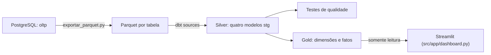
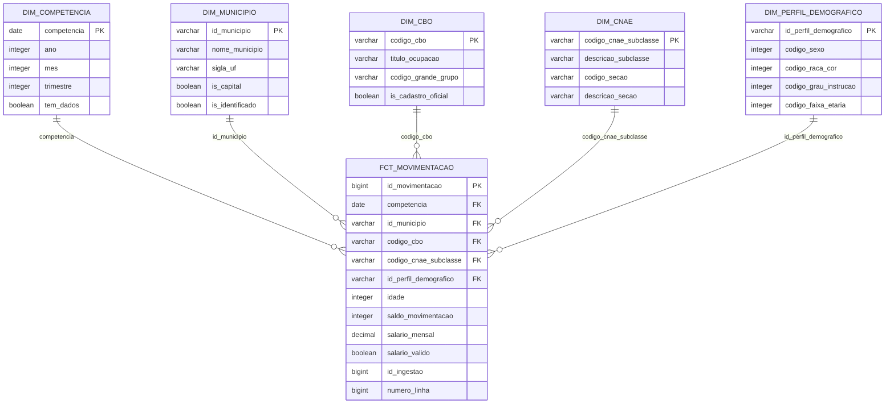

# Camada analítica com dbt

O projeto contém as cinco fontes Parquet, os quatro modelos Silver, as cinco dimensões e quatro fatos Gold, mais o histórico SCD tipo 2 da CBO (`snp_cbo` e `dim_cbo_historico`). Os testes genéricos cobrem as fontes, a Silver e a Gold, e os testes Python de negócio complementam esses contratos. O diagrama abaixo representa os modelos atuais.

## Fluxo e arquivos



As fontes são `movimentacao`, `municipio`, `cbo_2002`, `cnae_subclasse` e `cnae_secao`. O caminho é `data/lake/parquet/<tabela>/**/*.parquet`, com `hive_partitioning=false`; não é um único conjunto plano de arquivos. A transformação Silver normaliza nomes, acrescenta flags e mantém os códigos como texto. O join entre subclasse e seção CNAE produz `stg_cnae`.

O destino padrão é **`data/metra_analitico.duckdb`** (schemas `silver`, `gold` e `snapshots`), compartilhado entre o dbt, o Dagster e o painel Streamlit via `METRA_DUCKDB`. `data/metra.duckdb` permanece restrito ao script standalone `src/analise.py` da E2. Execuções de escrita são coordenadas pelo orquestrador, enquanto o painel abre o banco exclusivamente em modo `READ_ONLY`.

---

## Executar e inspecionar os testes

Após a carga OLTP e a exportação descritas no [README](https://github.com/unb-bd2-2026-2-grupo-4/METRA#readme), na raiz do repositório:

```bash
python3 -m pip install -r requirements-pipeline.txt
cd dbt_metra
dbt build --profiles-dir .
dbt test --profiles-dir .
dbt docs generate --profiles-dir .
```

`dbt build` executa modelos e testes em ordem de dependência. `dbt test` verifica o estado materializado sem reconstruí-lo. Preserve `target/manifest.json` e `target/run_results.json` como artefatos da execução no Dagster/CI, associados ao lote e ao commit; não os versione como dados de negócio. Esses arquivos são locais e ignorados pelo Git.

Para apontar para outro lake ou destino, use caminhos absolutos nas variáveis `METRA_LAKE_PARQUET` e `METRA_DUCKDB`. O diretório pai do banco deve existir.

### Matriz de qualidade implementada

| Categoria | O que é verificado | Local |
|---|---|---|
| Schema | Colunas e tipos materializados, incluindo códigos textuais, competência `DATE` e salário `DECIMAL(16,2)` | `models/staging/schema.yml` |
| Obrigatoriedade e unicidade | PKs, atributos obrigatórios e par `(id_ingestao, numero_linha)` | Fontes e Silver |
| Integridade referencial | Município, CBO e CNAE da movimentação; seção da subclasse na origem | Fontes e Silver |
| Domínios | Ano 2023–2026, mês 1–12, saldo ±1, sexo, raça/cor, UF e seção CNAE | Fontes/Silver conforme coluna |
| Limites | Idade nula ou 10–120; salário/horas nulos ou não negativos; IDs de linhagem positivos | Silver |
| Formatos | Município e CNAE com 7 dígitos; CBO com 6, inclusive zeros à esquerda | Silver |
| Coerência | Competência, tipo de evento, salário válido, sentinelas, capitais do recorte e flags de cadastros | Silver |
| Volume | Tabelas não vazias; referências com mesma contagem da origem; movimentos com total de IDs distintos da origem | Fontes e Silver |
| Distribuição | Conservação das contagens por competência, por competência/município e por perfil/saldo | Silver versus Parquet |
| Série temporal | Meses ausentes e razão de volume mensal fora de 0,25–4 vezes o mês anterior | Aviso em `silver_volume_mensal` |

As definições dos modelos antes mantidas em `_staging__models.yml` foram concentradas em `schema.yml`, evitando dois patches dbt para o mesmo modelo. Os testes genéricos SQL estão em `tests/generic/qualidade.sql`, dentro de `dbt_metra/`, e não exigem `dbt-utils`.

Os testes seguem os domínios da migração OLTP existente. Escolaridade e tipo detalhado de movimentação têm obrigatoriedade, mas ainda não uma lista oficial de valores aceitos: isso depende do dicionário validado pela equipe. Idade nula, salário/horas nulos ou zero e os sentinelas documentados são aceitos. Essas exceções não devem ser convertidas em “dados válidos para toda análise”: a média salarial usa apenas salários positivos.

### Como tratar uma falha

- **Erro:** não promover o resultado para consumo; investigar fonte, chave ou transformação, corrigir e reexecutar. `dbt build` não garante rollback global de todos os modelos: uma publicação atômica do banco é responsabilidade da integração com o Dagster.
- **Aviso de distribuição temporal:** investigar mês parcial, sazonalidade, atraso e falha de ingestão. Os limites são critérios operacionais iniciais, não limites estatísticos calibrados. Não usar `--warn-error` indiscriminadamente sem decidir essa política.
- **Duplicata na fonte:** o snapshot Parquet 1:1 deveria ter PK única. A deduplicação de `stg_movimentacao` permanece, mas não deve ocultar defeito na extração; o teste de unicidade da fonte sinaliza o problema.
- **CNAE sem seção:** o teste na fonte captura a referência ausente antes que o `inner join` a descarte. A reconciliação de contagem também protege contra perda silenciosa.

### Reprodução sem banco de origem

```bash
# Na raiz, no ambiente Python com as dependências instaladas:
python -m unittest discover -s tests -p 'test_dbt_quality.py' -v
```

A suíte cria cinco conjuntos Parquet sintéticos em diretório temporário, executa o dbt real e remove os arquivos ao terminar. Não usa `data/lake/` nem exige PostgreSQL ou rede depois da instalação. O cenário válido tem 12 movimentos em três competências, incluindo nulos permitidos, sentinelas e códigos com zero inicial. Os cenários negativos verificam alteração de tipo, dados inválidos, duplicação, referências ausentes, mudança de distribuição sem mudança do total, tabela vazia e mês ausente. Isso valida os testes, não substitui a execução sobre a carga real completa.

---

## Star Schema implementado na Gold

**Grão da fato:** uma linha por movimentação de admissão ou desligamento do Novo CAGED, identificada por `id_movimentacao` da origem. Não é uma linha por trabalhador, por vínculo ativo ou por município/mês. Os microdados utilizados não permitem estimar individualmente a probabilidade de recolocação.

As marcações PK/FK abaixo expressam as chaves e relações lógicas dos modelos dbt; não significam que o DuckDB tenha constraints físicas declaradas. Os nomes correspondem aos arquivos de `models/marts/`.



`fct_movimentacao` preserva o detalhe da Silver e acrescenta os atributos das dimensões por `left join`. A chave do perfil é a combinação dos códigos de sexo, raça/cor, escolaridade e faixa etária. A dimensão de competência preenche o intervalo mensal observado e marca os meses que possuem registros com `tem_dados`.

As três fatos agregadas derivam de `fct_movimentacao`, filtrando municípios identificados do Centro-Oeste e anos de 2023 a 2026:

| Modelo | Grão: uma linha por combinação de |
|---|---|
| `fct_setor_mensal` | `competencia`, `sigla_uf`, `codigo_secao` |
| `fct_geografia_mensal` | `competencia`, `sigla_uf`, `is_capital` |
| `fct_perfil_mensal` | `competencia`, `sigla_uf`, `is_capital`, `codigo_secao`, `id_perfil_demografico` |

As métricas são compartilhadas pela macro `metricas_movimentacao`; incluem contagens, saldo, soma salarial e quantidade de salários de admissão elegíveis, para recompor médias ponderadas. A implementação das perguntas P1–P5 é descrita em `dbt_metra/analyses/README.md` no repositório.

### Variação lenta: SCD tipo 2 da CBO

O snapshot dbt `snp_cbo` (`dbt_metra/snapshots/snp_cbo.yml`) compara, a cada `dbt build`, o título, o grande grupo e a origem do cadastro de cada ocupação de `stg_cbo` (estratégia `check`). Uma mudança encerra a versão anterior e abre uma nova, em vez de sobrescrevê-la; uma ocupação que sai da fonte tem a versão vigente encerrada (`hard_deletes: invalidate`), sem perder o histórico. O snapshot fica no schema `snapshots` do mesmo arquivo DuckDB e persiste entre execuções.

`gold.dim_cbo_historico` expõe uma linha por versão, com `id_versao_cbo`, `observado_desde`, `observado_ate` e `is_versao_vigente`. Os intervalos `[observado_desde, observado_ate)` registram quando o projeto **observou** cada cadastro; a fonte atual não fornece vigência histórica da ocupação. Não atribuir retroativamente a 2023 uma validade que só começou a ser observada em 2026.

`gold.dim_cbo` continua sendo a versão vigente (tipo 1), usada pelos fatos e pelo painel. A associação persistida de cada fato à versão observada no momento da carga (`referencia_cadastro_em`) não foi implementada: um rebuild completo da fato usa sempre o cadastro vigente.

Os contratos do histórico são verificados pelo teste singular `tests/assert_cbo_uma_versao_vigente.sql` (no máximo uma versão vigente por ocupação e períodos encadeados, sem sobreposição), pelos `data_tests` de `dim_cbo_historico` e por `tests/test_scd_cbo.py`, que executa o dbt duas vezes, muda um título na fonte entre as execuções e confere que a versão anterior foi preservada e encerrada.

### Contratos de teste da Gold

| Contrato Gold | Testes |
|---|---|
| Grão da fato | `not_null`/`unique` de `id_movimentacao`; contagem e saldo iguais à Silver |
| Dimensões | PK única/não nula e FKs da fato sem órfãos, inclusive sentinelas |
| CBO SCD2 | Chave de versão única; no máximo uma versão aberta por código; intervalo positivo; ausência de sobreposição; associação da fato dentro do intervalo de observação |
| Perfil e competência | Unicidade do conjunto de códigos do perfil; mês/ano coerentes; zero duplicação em joins |
| Agregados de consumo | Admissões/desligamentos/saldo reconciliados; salário calculado por soma/contagem válida, nunca média de médias |
| Distribuição | Mesmos totais por UF, competência, setor e perfil antes e depois da modelagem |

Os 54 testes da Gold estão no YAML de contratos (`models/marts/_gold__models.yml`) e em `tests/assert_cbo_uma_versao_vigente.sql`: `unique` e `not_null` nas chaves das dimensões e da fato, `relationships` da fato e dos agregados para as dimensões, `accepted_values` do saldo, contagem da fato igual à Silver (`metra_same_count`), unicidade do grão dos agregados mensais (`metra_unique_combination`) e os contratos do SCD tipo 2. A reconciliação de totais e de médias salariais entre agregados fica nos testes de negócio de `tests/test_gold.py`, que complementam esses contratos. Na amostra versionada, `dbt build` executa os 14 modelos, o snapshot e os 176 testes sem falhas.

---

## Freshness e próximos critérios de aceite

**SLA proposto para validação da equipe:** publicar consumo validado em até 24 horas após o sucesso da extração do snapshot completo. Medir `publicacao_validada_em - extracao_concluida_em` para o mesmo lote; alerta quando exceder o SLA. Esses metadados ainda precisam ser persistidos pelo fluxo de orquestração.

`max(competencia)` indica cobertura temporal do dado, não freshness de processamento. O conjunto disponível pode terminar em janeiro/2026 e ainda ter sido processado hoje. `registrado_em` também não substitui o instante da extração.

O benchmark da [ADR-0005](adr/0005-modelagem-analitica-dbt.md) compara granularidades sobre a amostra. A otimização da Gold é medida separadamente, na seção seguinte; retry e backfill estão demonstrados em [Orquestração](orquestracao.md#retry-agendamento-e-backfill).

---

## Consulta otimizada: EXPLAIN antes e depois

`src/qualidade/comparar_explain.py` responde à P1 (admissões, desligamentos, saldo e salários por seção CNAE no DF, nos últimos 12 meses da base) de três formas e exige que as respostas sejam idênticas:

- **origem:** PostgreSQL sobre o OLTP 3FN, com `EXPLAIN (ANALYZE, BUFFERS)`;
- **antes:** DuckDB agregando a fato detalhada `gold.fct_movimentacao`;
- **depois:** DuckDB somando o agregado mensal `gold.fct_setor_mensal`, que o dbt materializa a partir da mesma fato.

O DuckDB não oferece a opção `BUFFERS`; para ele, a evidência é o plano do `EXPLAIN ANALYZE`, com as linhas lidas por operador, e a mediana de 30 execuções com uma thread.

| Base | Antes: `fct_movimentacao` | Depois: `fct_setor_mensal` | Ganho |
|---|---|---|---|
| Completa (14.753.112 movimentações) | 33,27 ms; o scan devolve 918.397 linhas após os filtros | 0,84 ms; o scan devolve 251 linhas | ≈ 40× |
| Amostra versionada (49.178) | 0,50 ms | 0,90 ms | sem ganho |

Na base completa, o agregado elimina a leitura de quase um milhão de linhas por consulta. Na amostra, as duas formas ficam abaixo de 1 ms e o custo fixo de executar a consulta domina: o agregado não compensa nesse volume, e a amostra não serve como evidência de desempenho. Na origem, a mesma pergunta sobre a amostra leva 3,8 ms no PostgreSQL, com 9.910 páginas lidas do cache compartilhado (`shared hit`), a maior parte em 3.062 buscas por índice na tabela de subclasses CNAE para resolver a seção de cada movimentação.

A base completa não está no PostgreSQL do projeto; a Gold completa foi construída num diretório temporário a partir dos CSVs integrais pelo construtor de `src/app/banco_analitico.py`, com os 176 testes dbt aprovados. Evidências: [`0005-explain-completo.json`](https://github.com/unb-bd2-2026-2-grupo-4/METRA/blob/main/docs/adr/evidencias/0005-explain-completo.json) e [`0005-explain-amostra.json`](https://github.com/unb-bd2-2026-2-grupo-4/METRA/blob/main/docs/adr/evidencias/0005-explain-amostra.json), com os planos completos.

```bash
# Amostra, com o PostgreSQL do Compose e as variáveis PG* exportadas
python -m src.qualidade.comparar_explain --saida docs/adr/evidencias/0005-explain-amostra.json
# Outro banco DuckDB sem a origem correspondente (ex.: base completa)
python -m src.qualidade.comparar_explain --banco <arquivo.duckdb> --sem-origem --saida <arquivo.json>
```

Referências de implementação: [testes declarativos dbt](https://docs.getdbt.com/reference/resource-properties/data-tests) e [testes genéricos SQL](https://docs.getdbt.com/best-practices/writing-custom-generic-tests).
