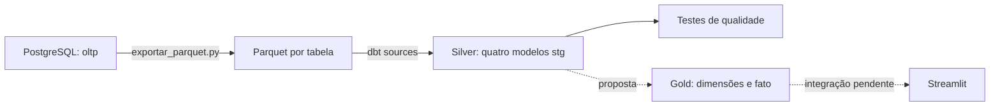
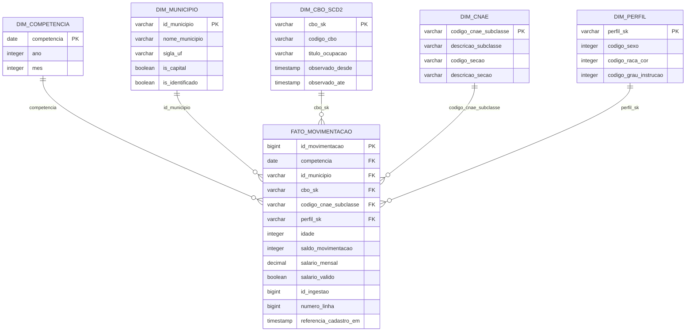

# Camada analítica com dbt

**Estado em 29/10/2026:** as cinco fontes Parquet, os quatro modelos Silver e seus testes estão implementados. A pasta `dbt_metra/models/marts/` ainda não contém modelos Gold. O Star Schema desta página é uma **proposta de contrato para integração com Tiago**, não um retrato de tabelas já criadas.

## Fluxo e arquivos



As fontes são `movimentacao`, `municipio`, `cbo_2002`, `cnae_subclasse` e `cnae_secao`. O caminho é `data/lake/parquet/<tabela>/**/*.parquet`, com `hive_partitioning=false`; não é um único conjunto plano de arquivos. A transformação Silver normaliza nomes, acrescenta flags e mantém os códigos como texto. O join entre subclasse e seção CNAE produz `stg_cnae`.

O destino padrão é **`data/metra_analitico.duckdb`**, schema `silver`. `data/metra.duckdb` é usado pela análise anterior: o painel e o Dagster devem respeitar `METRA_DUCKDB` ou alinhar essa configuração antes da integração. Execuções concorrentes de escrita devem ser coordenadas pelo orquestrador.

## Executar e inspecionar os testes

Após a carga OLTP e a exportação descritas no [README](https://github.com/unb-bd2-2026-2-grupo-4/ProjetoIntegrado#readme), na raiz do repositório:

```bash
python3 -m pip install -r requirements-pipeline.txt
cd dbt_metra
dbt build --profiles-dir .
dbt test --profiles-dir .
dbt docs generate --profiles-dir .
```

`dbt build` executa modelos e testes em ordem de dependência. `dbt test` verifica o estado materializado sem reconstruí-lo. Preserve `target/manifest.json` e `target/run_results.json` como artefatos da execução no Dagster/CI, associados ao lote e ao commit; não os versione como dados de negócio. Esses arquivos são locais e ignorados pelo Git.

Para apontar para outro lake ou destino, use caminhos absolutos nas variáveis `METRA_LAKE_PARQUET` e `METRA_DUCKDB`. O diretório pai do banco deve existir.

### Matriz de qualidade implementada

| Categoria | O que é verificado | Local |
|---|---|---|
| Schema | Colunas e tipos materializados, incluindo códigos textuais, competência `DATE` e salário `DECIMAL(16,2)` | `models/staging/schema.yml` |
| Obrigatoriedade e unicidade | PKs, atributos obrigatórios e par `(id_ingestao, numero_linha)` | Fontes e Silver |
| Integridade referencial | Município, CBO e CNAE da movimentação; seção da subclasse na origem | Fontes e Silver |
| Domínios | Ano 2023–2026, mês 1–12, saldo ±1, sexo, raça/cor, UF e seção CNAE | Fontes/Silver conforme coluna |
| Limites | Idade nula ou 10–120; salário/horas nulos ou não negativos; IDs de linhagem positivos | Silver |
| Formatos | Município e CNAE com 7 dígitos; CBO com 6, inclusive zeros à esquerda | Silver |
| Coerência | Competência, tipo de evento, salário válido, sentinelas, capitais do recorte e flags de cadastros | Silver |
| Volume | Tabelas não vazias; referências com mesma contagem da origem; movimentos com total de IDs distintos da origem | Fontes e Silver |
| Distribuição | Conservação das contagens por competência, por competência/município e por perfil/saldo | Silver versus Parquet |
| Série temporal | Meses ausentes e razão de volume mensal fora de 0,25–4 vezes o mês anterior | Aviso em `silver_volume_mensal` |

As definições dos modelos antes mantidas em `_staging__models.yml` foram concentradas em `schema.yml`, evitando dois patches dbt para o mesmo modelo. Os testes genéricos SQL estão em `tests/generic/qualidade.sql`, dentro de `dbt_metra/`, e não exigem `dbt-utils`.

Os testes seguem os domínios da migração OLTP existente. Escolaridade e tipo detalhado de movimentação têm obrigatoriedade, mas ainda não uma lista oficial de valores aceitos: isso depende do dicionário validado pela equipe. Idade nula, salário/horas nulos ou zero e os sentinelas documentados são aceitos. Essas exceções não devem ser convertidas em “dados válidos para toda análise”: a média salarial usa apenas salários positivos.

### Como tratar uma falha

- **Erro:** não promover o resultado para consumo; investigar fonte, chave ou transformação, corrigir e reexecutar. `dbt build` não garante rollback global de todos os modelos: uma publicação atômica do banco é responsabilidade da integração com o Dagster.
- **Aviso de distribuição temporal:** investigar mês parcial, sazonalidade, atraso e falha de ingestão. Os limites são critérios operacionais iniciais, não limites estatísticos calibrados. Não usar `--warn-error` indiscriminadamente sem decidir essa política.
- **Duplicata na fonte:** o snapshot Parquet 1:1 deveria ter PK única. A deduplicação de `stg_movimentacao` permanece, mas não deve ocultar defeito na extração; o teste de unicidade da fonte sinaliza o problema.
- **CNAE sem seção:** o teste na fonte captura a referência ausente antes que o `inner join` a descarte. A reconciliação de contagem também protege contra perda silenciosa.

### Reprodução sem banco de origem

```bash
# Na raiz, no ambiente Python com as dependências instaladas:
python -m unittest discover -s tests -p 'test_dbt_quality.py' -v
```

A suíte cria cinco conjuntos Parquet sintéticos em diretório temporário, executa o dbt real e remove os arquivos ao terminar. Não usa `data/lake/` nem exige PostgreSQL ou rede depois da instalação. O cenário válido tem 12 movimentos em três competências, incluindo nulos permitidos, sentinelas e códigos com zero inicial. Os cenários negativos verificam alteração de tipo, dados inválidos, duplicação, referências ausentes, mudança de distribuição sem mudança do total, tabela vazia e mês ausente. Isso valida os testes, não substitui a execução sobre a carga real completa.

## Star Schema proposto

**Grão da fato:** uma linha por movimentação de admissão ou desligamento do Novo CAGED, identificada por `id_movimentacao` da origem. Não é uma linha por trabalhador, por vínculo ativo ou por município/mês. Os microdados utilizados não permitem estimar individualmente a probabilidade de recolocação.



Os nomes e chaves acima precisam ser alinhados com Tiago. A idade permanece na fato para permitir faixas sem multiplicar a dimensão de perfil. Os códigos naturais de município/CNAE podem servir como PK; a CBO versionada exige uma chave por versão. Tabelas agregadas para o painel podem derivar da fato, preservando contagens e somas necessárias para recalcular médias ponderadas.

### Variação lenta e testes Gold a integrar

A proposta é preservar mudanças do título CBO por **SCD tipo 2**, em vez de sobrescrever versões. Os intervalos `[observado_desde, observado_ate)` registram quando o projeto observou cada cadastro; a fonte atual não fornece vigência histórica da ocupação. Não atribuir retroativamente a 2023 uma validade que só começou a ser observada em 2026.

`referencia_cadastro_em` seria o instante de associação do fato ao cadastro observado, distinto da competência de negócio e de `registrado_em` da origem. Essa associação deve ser persistida; um rebuild que troca todas as chaves pela versão atual destruiria a história. Snapshot, política de associação da carga inicial e preservação de chaves ainda precisam de implementação na Gold.

| Contrato Gold pendente | Testes a conectar ao modelo real |
|---|---|
| Grão da fato | `not_null`/`unique` de `id_movimentacao`; contagem e saldo iguais à Silver |
| Dimensões | PK única/não nula e FKs da fato sem órfãos, inclusive sentinelas |
| CBO SCD2 | Chave de versão única; no máximo uma versão aberta por código; intervalo positivo; ausência de sobreposição; associação da fato dentro do intervalo de observação |
| Perfil e competência | Unicidade do conjunto de códigos do perfil; mês/ano coerentes; zero duplicação em joins |
| Agregados de consumo | Admissões/desligamentos/saldo reconciliados; salário calculado por soma/contagem válida, nunca média de médias |
| Distribuição | Mesmos totais por UF, competência, setor e perfil antes e depois da modelagem |

Não há testes habilitados referenciando tabelas Gold fictícias. Após a implementação dos modelos, adicionar `models/marts/schema.yml` e os testes SCD com seus nomes definitivos.

## Freshness e próximos critérios de aceite

**SLA proposto para validação da equipe:** publicar consumo validado em até 24 horas após o sucesso da extração do snapshot completo. Medir `publicacao_validada_em - extracao_concluida_em` para o mesmo lote; alerta quando exceder o SLA. Esses metadados ainda precisam ser persistidos pelo fluxo de orquestração.

`max(competencia)` indica cobertura temporal do dado, não freshness de processamento. O conjunto disponível pode terminar em janeiro/2026 e ainda ter sido processado hoje. `registrado_em` também não substitui o instante da extração.

A [E3](https://unb-bd2.github.io/PlanoEnsino/projeto/e3/) exige ainda retry/backfill demonstrados, consulta otimizada com evidências e painel. O benchmark da [ADR-0005](adr/0005-modelagem-analitica-dbt.md) compara granularidades sobre a amostra, mas não comprova otimização da Gold, SCD nem orquestração. Os comandos `EXPLAIN ANALYZE` anexos são do DuckDB; não equivalem ao `EXPLAIN (ANALYZE, BUFFERS)` PostgreSQL solicitado no checklist. Alinhar com a docente a evidência apropriada ao motor usado.

Referências de implementação: [testes declarativos dbt](https://docs.getdbt.com/reference/resource-properties/data-tests) e [testes genéricos SQL](https://docs.getdbt.com/best-practices/writing-custom-generic-tests).
