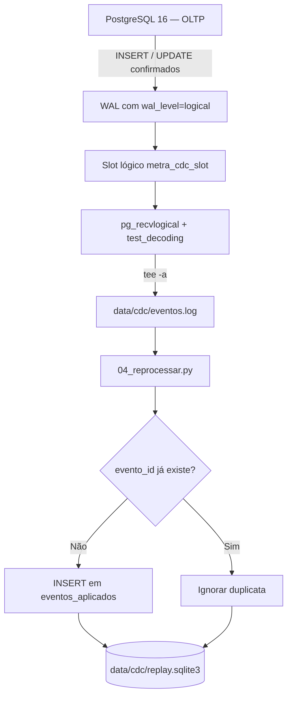

# Captura de Mudanças (CDC) e Reprocessamento Idempotente

A captura de mudanças (*Change Data Capture*, **CDC**) é o mecanismo da Entrega E2 do **METRA** responsável por observar modificações confirmadas no banco transacional (**PostgreSQL 16**, schema `oltp`) e disponibilizá-las a um destino externo. A implementação utiliza **decodificação lógica do WAL** (*Write-Ahead Log*) por meio do `pg_recvlogical` e do plugin `test_decoding`.

A saída bruta é registrada em `data/cdc/eventos.log`. Um consumidor Python separado permite **reprocessar os eventos** e **impedir a inserção repetida de eventos com a mesma identidade** no destino de demonstração (`data/cdc/replay.sqlite3`). Essa separação permite evidenciar tanto a propagação das mudanças quanto o comportamento em caso de replay.

---

## Arquitetura e fluxo de dados



O `pg_recvlogical` acompanha o slot de replicação e emite eventos textuais. O script de consumo grava essa saída em um arquivo local. Já o consumidor de replay lê o arquivo completo sob demanda e mantém o conjunto de eventos únicos aplicados no SQLite.

**O que cada componente faz:**

| Componente | Responsabilidade |
|---|---|
| PostgreSQL / WAL | Registrar alterações transacionais que possam ser decodificadas logicamente. |
| Slot `metra_cdc_slot` | Manter o estado de leitura necessário ao consumidor lógico. |
| Plugin `test_decoding` | Representar transações e mudanças em texto legível, para demonstração. |
| `pg_recvlogical` | Consumir a sequência de eventos a partir do slot. |
| `eventos.log` | Persistir localmente a saída **bruta**, sem deduplicação. |
| `04_reprocessar.py` | Interpretar transações completas, identificar eventos e aplicar deduplicação. |
| `replay.sqlite3` | Guardar um registro de cada evento aceito, com chave primária única. |

---

## Arquivos e artefatos

| Arquivo | Finalidade |
|---|---|
| `docker-compose.yml` | Configurar PostgreSQL para decodificação lógica do WAL. |
| `src/cdc/01_preparar.sh` | Verificar o WAL lógico, criar `oltp.cdc_probe` e, se necessário, o slot. |
| `src/cdc/02_consumir.sh` | Iniciar `pg_recvlogical` e anexar eventos a `data/cdc/eventos.log`. |
| `src/cdc/03_testar.sh` | Gerar um `INSERT` e um `UPDATE` de teste no OLTP. |
| `src/cdc/04_reprocessar.py` | Reprocessar o arquivo de eventos com deduplicação no SQLite. |
| `tests/test_cdc_replay.py` | Testar o reenvio do mesmo log e o descarte de transações incompletas. |
| `data/cdc/eventos.log` | Log bruto gerado em execução; não versionado. |
| `data/cdc/replay.sqlite3` | Banco local de demonstração; não versionado. |

Os arquivos de execução do CDC e a lógica de replay são independentes dos módulos de exportação Parquet e materialização Delta da E2.

---

## Decisões e regras da implementação

| Regra | Como é tratada |
|---|---|
| **CDC baseado no WAL** | PostgreSQL opera com `wal_level=logical` e alterações são lidas por `pg_recvlogical`. |
| **Propagação para arquivo** | O script `02_consumir.sh` usa `tee -a data/cdc/eventos.log`. |
| **Teste isolado** | A tabela `oltp.cdc_probe` recebe dados artificiais, sem alterar as movimentações oficiais do Novo CAGED. |
| **Transações completas** | O consumidor aplica somente blocos `BEGIN ... COMMIT` com o mesmo XID. |
| **Identidade do evento** | Hash SHA-256 de XID, índice da alteração na transação, tabela, operação e detalhes textuais. |
| **Deduplicação no destino** | `evento_id` é chave primária em `eventos_aplicados`; `INSERT OR IGNORE` descarta um evento já registrado. |
| **Atomicidade no SQLite** | A inserção dos eventos de uma transação decodificada ocorre dentro de uma transação SQLite. |
| **Reexecução** | Reler o mesmo arquivo não acrescenta ao SQLite registros de eventos já existentes. |
| **Persistência** | O banco SQLite é mantido entre execuções, permitindo reconhecer reentregas. |

A identidade calculada é estável **para a repetição das mesmas linhas do log**, mas não deve ser considerada uma identidade global de eventos para uso em produção. XIDs podem ser reutilizados ao longo do tempo; mudanças na formatação ou na origem podem comprometer essa identificação.

### Modelo do destino de replay

```sql
CREATE TABLE IF NOT EXISTS eventos_aplicados (
    evento_id TEXT PRIMARY KEY,
    xid TEXT NOT NULL,
    indice INTEGER NOT NULL,
    tabela TEXT NOT NULL,
    operacao TEXT NOT NULL,
    detalhes TEXT NOT NULL
);
```

Cada linha representa uma mudança capturada, **não a linha de negócio já atualizada em uma tabela analítica**. O destino registra eventos únicos; não executa `MERGE`, `UPDATE` ou `DELETE` em Parquet ou Delta.

---

## Como executar

Os comandos abaixo devem ser executados **na raiz do repositório**, com Docker Compose e Python 3 disponíveis. O serviço PostgreSQL do Compose deve se chamar `postgres`, como na implementação enviada.

### 1. Habilitar a decodificação lógica

No serviço `postgres` de `docker-compose.yml`, preserve a configuração já existente de WAL e habilite a leitura lógica, por exemplo:

```yaml
command: >
  postgres
  -c max_wal_size=4GB
  -c wal_level=logical
  -c max_replication_slots=4
  -c max_wal_senders=4
```

Recrie apenas o contêiner para aplicar os parâmetros:

```bash
docker compose up -d --force-recreate postgres
```

**Não execute `docker compose down -v`**, pois a remoção de volumes pode apagar os dados persistidos na E1.

### 2. Preparar tabela e slot

```bash
bash src/cdc/01_preparar.sh
```

O script verifica se `wal_level` está definido como `logical`, cria a tabela `oltp.cdc_probe` caso ela não exista e cria o slot `metra_cdc_slot` com `test_decoding` caso ainda não exista.

Para consultar o estado do slot:

```bash
docker compose exec -T postgres psql -U metra -d metra -c \
  "SELECT slot_name, plugin, slot_type, active, confirmed_flush_lsn FROM pg_replication_slots WHERE slot_name = 'metra_cdc_slot';"
```

> Os comandos acima usam o usuário e banco `metra`, que são os padrões dos scripts fornecidos. Ajuste-os caso o Compose tenha credenciais diferentes.

### 3. Iniciar a captura — Terminal A

```bash
bash src/cdc/02_consumir.sh
```

Mantenha esse terminal aberto. As mudanças capturadas aparecem na saída padrão e são anexadas a `data/cdc/eventos.log`.

### 4. Gerar alterações — Terminal B

```bash
bash src/cdc/03_testar.sh
```

Esse script executa operações `INSERT` e `UPDATE` em `oltp.cdc_probe` com uma descrição específica da execução. A tabela foi criada para não modificar dados reais do CAGED.

### 5. Consultar os eventos capturados

```bash
cat data/cdc/eventos.log
```

Para mostrar apenas as mudanças da tabela de demonstração:

```bash
grep 'table oltp.cdc_probe:' data/cdc/eventos.log
```

### 6. Processar o log pela primeira vez

```bash
python3 src/cdc/04_reprocessar.py
```

Por padrão, o consumidor lê `data/cdc/eventos.log` e utiliza `data/cdc/replay.sqlite3` como destino. Também é possível indicar outros caminhos:

```bash
python3 src/cdc/04_reprocessar.py \
  --log data/cdc/eventos.log \
  --db data/cdc/replay.sqlite3
```

Se o arquivo tiver **exatamente dois eventos confirmados** e o SQLite ainda estiver vazio, a saída esperada será:

```json
{"transacoes_confirmadas": 2, "novos": 2, "duplicados": 0, "total_destino": 2}
```

### 7. Reprocessar exatamente o mesmo arquivo

Sem apagar `eventos.log` nem `replay.sqlite3`, repita:

```bash
python3 src/cdc/04_reprocessar.py
```

Com o mesmo arquivo e sem novos eventos, a saída esperada passa a ser:

```json
{"transacoes_confirmadas": 2, "novos": 0, "duplicados": 2, "total_destino": 2}
```

O arquivo foi relido, mas a contagem de eventos únicos no destino permaneceu em dois. **É essa comparação entre as duas execuções que demonstra o replay idempotente.** Se houver mais eventos no log real, os números serão diferentes (a propriedade a verificar é que a segunda execução não aumenta `total_destino` quando a entrada não mudou).

---

## Evidência observada no CDC

Em um teste realizado, o arquivo `eventos.log` apresentado pela equipe continha:

```text
BEGIN 769
table oltp.cdc_probe: INSERT: id[bigint]:1 descricao[text]:'metra-1792261417-99158' atualizado_em[timestamp with time zone]:'2026-10-17 18:23:38.457866+00'
COMMIT 769
BEGIN 770
table oltp.cdc_probe: UPDATE: id[bigint]:1 descricao[text]:'metra-1792261417-99158-atualizado' atualizado_em[timestamp with time zone]:'2026-10-17 18:23:38.469911+00'
COMMIT 770
```

Esse registro comprova a **captura de um `INSERT` e um `UPDATE` efetivamente confirmados** e sua propagação até o arquivo local. O sufixo `-atualizado` mostra a alteração do mesmo registro de teste.

Os resultados numéricos de replay indicados acima são **saídas esperadas** para esse log de dois eventos; não devem ser descritos como execução observada no computador da equipe antes de rodar o consumidor localmente.

---

## Testes automatizados

```bash
python3 -m unittest discover -s tests -p 'test_cdc_replay.py' -v
```

O arquivo `tests/test_cdc_replay.py` contém dois testes:

| Teste | Verificação |
|---|---|
| `test_replay_mesmo_log_nao_duplicar` | Reprocessar duas vezes o mesmo log e anexá-lo novamente não aumenta o total de eventos únicos. |
| `test_ignora_transacao_incompleta` | Uma transação com `BEGIN`, mas sem `COMMIT`, não é inserida no destino. |

**Validação efetuada para esta documentação:** os dois testes unitários, executados em Python 3 sobre os arquivos de replay fornecidos, passaram (`Ran 2 tests ... OK`).

---

## Semântica de entrega e limitações

- **A captura bruta não deduplica:** `tee -a` sempre anexa os textos recebidos. Se a origem reenviar uma alteração, ela pode aparecer repetida em `eventos.log`.
- **Deduplicação é do consumidor:** a restrição `PRIMARY KEY` e `INSERT OR IGNORE` impedem a persistência repetida de **eventos identificados como iguais** no SQLite.
- **Replay não é uma nova alteração no PostgreSQL:** executar `04_reprocessar.py` novamente relê o log existente; isso não gera um novo `INSERT` na tabela OLTP.
- **Garantias condicionais:** o destino é idempotente para o cenário de reexecução do mesmo conteúdo, mas não há coordenação transacional entre avanço do slot, gravação em arquivo e escrita no SQLite. Por isso, **não se afirma `exactly-once` de ponta a ponta**.
- **Semântica at-least-once:** o desenho tolera duplicatas no destino de demonstração, quando identificadas; entretanto, uma garantia operacional integral de entrega *at-least-once* também exigiria recuperação durável e confirmação coordenada, o que não foi implementado aqui.
- **Sem sincronização com a camada analítica:** o consumidor não aplica automaticamente as mudanças do WAL às tabelas Parquet/Delta. Esse seria um passo de integração adicional.
- **Plugin de demonstração:** `test_decoding` gera texto de teste, e não um contrato estruturado de eventos para produção. Para maior robustez, considerar `pgoutput` com um conector CDC apropriado e metadados de origem estáveis.
- **Retenção do WAL:** o slot pode reter arquivos WAL se deixar de consumir; monitorar o uso de disco.
- **Transações desconhecidas:** o parser de replay abandona uma transação ao encontrar conteúdo inesperado; os testes cobrem apenas os formatos presentes na implementação atual.

Consulta útil para monitorar WAL retido:

```bash
docker compose exec -T postgres psql -U metra -d metra -c \
  "SELECT slot_name, active, pg_size_pretty(pg_wal_lsn_diff(pg_current_wal_lsn(), restart_lsn)) AS wal_retido FROM pg_replication_slots WHERE slot_name = 'metra_cdc_slot';"
```

Após finalizar **definitivamente** o experimento e parar o consumidor, o slot pode ser removido conscientemente. Não remova o slot se ainda precisar preservar a posição de leitura:

```bash
docker compose exec -T postgres pg_recvlogical \
  -U metra -d metra --slot=metra_cdc_slot --drop-slot
```
