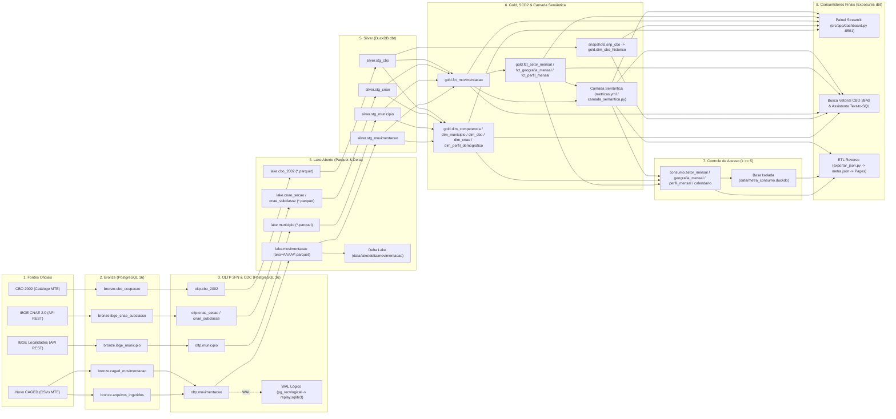

# Consumo e governança

**Documento de integração atualizado em 23/11/2026.** O repositório já contém ingestão, OLTP, exportação Parquet/Delta, camadas Silver e Gold com 176 testes dbt de qualidade, SCD tipo 2 da CBO (`gold.dim_cbo_historico`), orquestração Dagster (com retry, schedule e backfill), a integração da Busca Semântica CBO + Assistente Text-to-SQL Governado no painel Streamlit (`src/app/dashboard.py`, validada na [ADR-0007](adr/0007-busca-semantica-e-consumo.md)), a camada semântica única de métricas (`dbt_metra/models/semantic/metricas.yml`), o controle de acesso por views de consumo agregadas e base isolada (`data/metra_consumo.duckdb`), o enquadramento de governança LGPD com script de descarte executado (`src/lgpd/descarte.py`) e o ETL reverso para JSON público (`src/consumo/exportar_json.py`).

## Camada semântica: catálogo único de métricas

Cada métrica tem **uma única definição versionada**, em [`dbt_metra/models/semantic/metricas.yml`](https://github.com/unb-bd2-2026-2-grupo-4/METRA/blob/main/dbt_metra/models/semantic/metricas.yml), no formato de `semantic_models` e `metrics` do dbt. O dbt valida esse arquivo a cada `parse`/`build`, e ele aparece no `manifest.json` e no `dbt docs`. Todos os pontos de consumo compilam o SQL da métrica a partir dele, sem fórmula própria:

| Consumidor | Como lê a definição |
|---|---|
| Marts da Gold (`fct_setor_mensal`, `fct_geografia_mensal`, `fct_perfil_mensal`) e análises `p1`–`p5` | Macro dbt `metrica(nome, origem)` (`dbt_metra/macros/metricas.sql`), que lê o grafo do dbt |
| Painel Streamlit, busca CBO e assistente Text-to-SQL | `src.metricas.camada_semantica.expressao()` / `montar_consulta()` |
| Exportação JSON e ETL reverso (E4) | `src.metricas.camada_semantica.consultar()` |

Medidas aditivas, com o mesmo nome das colunas dos marts, sobre `gold.fct_movimentacao` (uma linha por movimentação, recorte `is_identificado and is_centro_oeste and ano between 2023 and 2026`):

| Medida | Agregação sobre os eventos |
|---|---|
| `admissoes` | `count` de `saldo_movimentacao = 1` |
| `desligamentos` | `count` de `saldo_movimentacao = -1` |
| `saldo` | `sum(saldo_movimentacao)` |
| `soma_salarios_admissao` | `sum` do salário das admissões com `salario_valido` |
| `qtd_salarios_admissao` | `count` das admissões com `salario_valido` |

Métricas publicadas:

| Métrica | Tipo | Definição | Unidade e ressalva |
|---|---|---|---|
| Admissões | simples | medida `admissoes` | Movimentações, não pessoas distintas |
| Desligamentos | simples | medida `desligamentos` | Movimentações |
| Saldo líquido | simples | medida `saldo` (admissões − desligamentos) | Fluxo líquido; não é estoque de vínculos |
| Admissões com salário válido | simples | medida `qtd_salarios_admissao` | Denominador da média; deve acompanhar o valor exibido |
| Salário médio de admissão | razão | `soma_salarios_admissao` / `qtd_salarios_admissao` | R$ nominais; nulo quando não há admissão com salário válido |
| Índice de fluxos pareados (turnover proxy) | derivada | `200 × least(admissoes, desligamentos) / (admissoes + desligamentos)` ([ADR-0007](adr/0007-busca-semantica-e-consumo.md)) | 0 a 100%; não é taxa sobre estoque de vínculos (indisponível no CAGED) |

A métrica tem duas origens. Sobre **eventos** (`gold.fct_movimentacao`), cada medida aplica sua agregação. Sobre **agregados** (marts ou CTEs que já trazem as medidas), a recomposição é sempre `sum(<medida>)`. Por isso o salário médio é sempre a razão das somas, e nunca a média simples de médias. Com `janela=`, a mesma métrica é recomposta sobre uma janela nomeada; a P5 usa isso para a média do recorte.

Recortes analíticos (série mensal, capital/interior, disparidade por sexo, raça/cor, escolaridade e faixa etária) são as mesmas métricas agrupadas por dimensão. Categorias não informadas permanecem identificadas; não se atribuem valores demográficos ausentes. A disparidade é uma associação descritiva, sem inferir causalidade nem probabilidade individual de recolocação.

**Garantias testadas:**

- `tests/test_camada_semantica.py` confere a definição, o SQL compilado e os valores calculados à mão. Também **falha se algum consumidor voltar a escrever uma fórmula de métrica à mão**.
- `tests/test_dbt_quality.py` confere que o macro dbt e o compilador Python geram **SQL idêntico** nos marts e nas cinco análises.
- `tests/test_gold_integracao.py` confere na Gold real que a mesma métrica dá o mesmo valor a partir dos eventos e de cada mart, e que os KPIs do painel batem com a camada semântica.

Ficam de fora da regra, de propósito, os gabaritos independentes: os scripts de medição em `src/qualidade/`, o avaliador da ADR-0007 e as referências dos testes de conciliação. Eles recalculam os números por conta própria justamente para conferir a camada semântica.

### Correspondência com as perguntas publicadas

| Pergunta | Recorte necessário | Tratamento implementado no consumo |
|---|---|---|
| P1: setores no DF nos últimos 12 meses | UF DF, seção CNAE e janela de 12 competências | Âncora na última competência disponível (ou no ano filtrado), exibindo o intervalo e o número de competências no painel |
| P2: sazonalidade | Série mensal por ano | Distingue meses sem dados (`NULL`) de zero observado (`0`) e calcula médias sazonais apenas sobre anos completos (12 meses) |
| P3: capitais versus interior | Município identificado, flag de capital, ano (2023–2026) e competência | Série anual (2023–2026), consolidado (`Total`) e recorte por UF conciliados com `python3 -m src.analise` |
| P4: turnover e salário | Setor, competência, salário válido e fluxos mensais | Usa o índice de fluxos pareados (`indice_fluxos_pareados_pct`) e a correlação de Pearson com `salario_medio_admissao` como aproximação explícita ([ADR-0007](adr/0007-busca-semantica-e-consumo.md)) |
| P5: perfil e remuneração | Sexo, raça/cor, idade e escolaridade | Associação descritiva com nota metodológica explícita de que fluxos observados não estimam chance individual de recolocação |

## Catálogo de dados (`dbt docs` no Pages) e linhagem da fonte ao painel e ao ETL reverso

O catálogo completo do projeto (**5 fontes Parquet**, **4 modelos Silver**, **1 snapshot SCD Tipo 2**, **11 modelos Gold/Time Spine**, **4 views públicas de Consumo**, **7 métricas da camada semântica**, **5 análises P1–P5**, **4 exposures de consumo final** e **210 testes declarativos dbt**) é compilado em um portal estático interativo por `src/catalogo/gerar_dbt_docs.py` (`dbt docs generate --static`) e publicado automaticamente no GitHub Pages pelo workflow `.github/workflows/deploy-docs.yml`.

- **Catálogo interativo `dbt docs` (DAG e dicionário de colunas):** <a href="../assets/dbt-docs/index.html" target="_blank" rel="noopener">Abrir portal `dbt docs` do METRA em tela cheia (`assets/dbt-docs/index.html`)</a>
- **Manifesto auditável de catálogo e linhagem versionado no repositório:** [`docs/assets/dbt-docs/linhagem.json`](https://github.com/unb-bd2-2026-2-grupo-4/METRA/blob/main/docs/assets/dbt-docs/linhagem.json)

### Grafo de linhagem ponta a ponta (da fonte ao painel e ao ETL reverso)



### Matriz de linhagem da fonte até o painel e o ETL reverso

| Domínio / Atributo | 1. Fonte → 2. Bronze → 3. OLTP (`PostgreSQL 16`) | 4. Lake (`Parquet`/`Delta`) → 5. Silver (`DuckDB`) | 6. Gold, SCD2 e Camada Semântica (`dbt`) | 7. Consumo Interno (Painel Streamlit e Text-to-SQL) | 8. Controle de Acesso e ETL Reverso (`metra.json` no Pages) |
|---|---|---|---|---|---|
| **Linhagem física do lote** (`id_ingestao`, `numero_linha`, `sha256`) | CSV CAGED → `bronze.arquivos_ingeridos` + `bronze.caged_movimentacao` → `oltp.movimentacao` | `lake.movimentacao` (+ tabela Delta) → `silver.stg_movimentacao` | Preservada em `gold.fct_movimentacao` para auditoria até a linha do CSV bruto | Bloqueada no validador `validar_sql_seguro` (LGPD) e omitida nas telas públicas | Omitida das views `consumo.*`, de `metra_consumo.duckdb` e de `metra.json` |
| **Tempo e cobertura** (`ano`, `mes`, `competencia`, `tem_dados`) | Campos `ano`/`mes` do CAGED → `bronze.caged_movimentacao` → `oltp.movimentacao` | Partição `ano=AAAA/` em `lake.movimentacao` → `stg_movimentacao.competencia` (`DATE`) | `gold.dim_competencia`, `gold.metricflow_time_spine` e chave temporal dos 3 marts mensais | Filtro de Ano, janela móvel de 12 meses (P1), curva sazonal (P2) e série anual 2023–2026 (P3) | `consumo.calendario` → `metra_consumo.duckdb` → coleção `calendario` em `docs/assets/dados/metra.json` |
| **Geografia e recorte capital/interior** (`id_municipio`, `sigla_uf`, `is_capital`) | API IBGE Localidades → `bronze.ibge_municipio` → `oltp.municipio` (com sentinela `9999999`) | `lake.municipio` → `silver.stg_municipio` (`is_identificado`, `is_centro_oeste`) | `gold.dim_municipio`, `gold.fct_movimentacao` e `gold.fct_geografia_mensal` | Filtro de UF na sidebar, aba **Capitais vs. Interior (P3)** e recorte geográfico por CBO | `consumo.geografia_mensal` (supressão $k \ge 5$, sem `id_municipio`) → coleção `geografia` em `metra.json` |
| **Ocupação e histórico SCD2** (`codigo_cbo`, `titulo_ocupacao`, `id_versao_cbo`) | Catálogo CBO 2002 (MTE) → `bronze.cbo_ocupacao` → `oltp.cbo_2002` | `lake.cbo_2002` → `silver.stg_cbo` (`codigo_grande_grupo`, `is_cadastro_oficial`) | `snapshots.snp_cbo` → `gold.dim_cbo_historico` (SCD2) e `gold.dim_cbo` (vigente) | Índice vetorial híbrido 384d (`IndiceVetorialCBO`) e drill-down por cargo nas abas P1–P5 | Omitida das views `consumo.*` e do JSON público para evitar reidentificação por profissão rara |
| **Atividade econômica** (`codigo_cnae_subclasse`, `codigo_secao`, `descricao_secao`) | API IBGE CNAE 2.0 → `bronze.ibge_cnae_subclasse` → `oltp.cnae_secao` + `oltp.cnae_subclasse` | `lake.cnae_secao` + `lake.cnae_subclasse` → join em `silver.stg_cnae` | `gold.dim_cnae`, `gold.fct_setor_mensal` e `gold.fct_perfil_mensal` | Filtro de Setor (Seção A–U), ranking setorial (P1) e matriz de rotatividade × salário (P4) | `consumo.setor_mensal` e `consumo.perfil_mensal` ($k \ge 5$, apenas `codigo_secao`) → coleções `setores` e `perfis` em `metra.json` |
| **Perfil sociodemográfico** (`sexo`, `raca_cor`, `grau_instrucao`, `idade`) | Microdados CAGED → `bronze.caged_movimentacao` → `oltp.movimentacao` | `lake.movimentacao` → `silver.stg_movimentacao` (validação de domínios e limites de idade 10–120) | `gold.dim_perfil_demografico` (`id_perfil_demografico` e faixas etárias) e `gold.fct_perfil_mensal` | Aba **Perfil Demográfico (P5)** e assistente Text-to-SQL (cruzamento com UF, ano, setor e CBO) | `consumo.perfil_mensal` (1 eixo por vez, sem cruzar eixos, $k \ge 5$) → coleção `perfis` em `metra.json` |
| **Fluxos e remuneração** (`saldo_movimentacao`, `salario_mensal`, `salario_valido`) | Microdados CAGED → `bronze.caged_movimentacao` → `oltp.movimentacao` | `lake.movimentacao` → `silver.stg_movimentacao` (`tipo_evento`, `salario_valido`) | Medidas e métricas em `dbt_metra/models/semantic/metricas.yml` (`admissoes`, `desligamentos`, `saldo`, `soma_salarios_admissao`, `qtd_salarios_admissao`, `salario_medio_admissao`, `indice_fluxos_pareados_pct`) | Compiladas por `src/metricas/camada_semantica.py` nos 4 KPIs globais, nas abas P1–P5 e no Text-to-SQL | Views `consumo.*` anulam `soma_salarios_admissao` e `qtd_salarios_admissao` quando $< 5$; `exportar_json.py` publica apenas a média e o denominador em `metra.json` |

### Consumidores finais declarados no grafo do `dbt docs` (`exposures`)

Para que o grafo de linhagem do `dbt docs` não termine nos modelos SQL e exiba os consumidores reais da camada de apresentação e do ETL reverso, o arquivo [`dbt_metra/models/consumo/_exposures.yml`](https://github.com/unb-bd2-2026-2-grupo-4/METRA/blob/main/dbt_metra/models/consumo/_exposures.yml) registra quatro *exposures*:

1. **`exposure.metra.painel_streamlit`** (`type: dashboard`): aplicação Streamlit (`src/app/dashboard.py`, porta `8501`), conectada às 5 dimensões, ao histórico SCD2 (`dim_cbo_historico`), às 4 tabelas fato da Gold e às métricas da camada semântica;
2. **`exposure.metra.assistente_text_to_sql_e_busca_cbo`** (`type: application`): índice vetorial CBO de 384 dimensões (`src/app/busca_cbo.py`) e assistente Text-to-SQL (`src/app/text_to_sql.py`);
3. **`exposure.metra.base_consumo_isolada`** (`type: application`): banco `data/metra_consumo.duckdb` publicado pelo asset `base_consumo` (`src/acesso/base_consumo.py`) a partir das quatro views `consumo.*`;
4. **`exposure.metra.etl_reverso_json_publico`** (`type: application`): exportador `src/consumo/exportar_json.py` (asset `exportar_json_consumo`) que alimenta `docs/assets/dados/metra.json` e a página interativa [Resumo mensal publicado](consumo-json.md).

Para regenerar localmente o portal estático do `dbt docs` e o manifesto de linhagem:

```bash
python -m src.catalogo.gerar_dbt_docs
python -m unittest discover -s tests -p 'test_catalogo_linhagem.py' -v
```

`id_ingestao` e `numero_linha` permitem voltar à origem da movimentação; `manifest.json` descreve as dependências dbt e `run_results.json` registra o resultado da execução. Esses artefatos estão integrados ao grafo de linhagem do Dagster em `dagster_metra/definitions.py` (ver [Orquestração com Dagster](orquestracao.md)). O replay CDC SQLite existente (`src/cdc/04_reprocessar.py`) demonstra a captura e deduplicação a partir do WAL do PostgreSQL e permanece desacoplado da carga em lote da Silver.

## Privacidade e governança LGPD: dados tratados, base legal, retenção e descarte

A fonte pública do Novo CAGED (MTE) não contém identificadores diretos (não há nome civil, CPF, RG, PIS/PASEP, NIT, CTPS nem CNPJ do empregador). No entanto, cada registro de movimentação nas camadas internas (`bronze.caged_movimentacao`, `oltp.movimentacao`, `data/lake/parquet/movimentacao/`, `data/lake/delta/movimentacao/`, `silver.stg_movimentacao` e `gold.fct_movimentacao`) combina **quase-identificadores** (`id_municipio`, `competencia`, `ano`, `mes`, `codigo_cbo`, `codigo_cnae_subclasse`, `idade`, `codigo_sexo`, `codigo_grau_instrucao`, `salario_mensal`, `horas_contratuais`, `tipo_movimentacao`, `saldo_movimentacao`, `id_ingestao` e `numero_linha`) e o atributo **`raca_cor` (`codigo_raca_cor`)**.

Na auditoria automatizada sobre as `49.178` movimentações do recorte do Centro-Oeste em `gold.fct_movimentacao` (`src/lgpd/descarte.py`), existem **`49.134` combinações distintas** de município × competência × CBO × subclasse CNAE × idade × perfil demográfico, das quais **`49.091` (`99,91%`) são únicas ($k = 1$)** e **`100,0%` possuem $k < 5$**. Por isso, a ausência de CPF não torna o microdado anonimizado: combinações raras permitem identificação indireta (art. 5º, I da [Lei nº 13.709/2018 — LGPD](https://www2.camara.leg.br/legin/fed/lei/2018/lei-13709-14-agosto-2018-787077-normaatualizada-pl.html)), e `raca_cor`, quando vinculada a pessoa identificável, constitui **dado pessoal sensível** sobre origem racial ou étnica (art. 5º, II da LGPD).

| Item | Enquadramento e implementação no METRA | Evidência e governança operacional |
|---|---|---|
| **Dados nomeados** | **Identificadores diretos:** nenhum na origem. **Quase-identificadores (art. 5º, I):** `id_municipio`, `competencia` (`ano`/`mes`), `codigo_cbo`, `codigo_cnae_subclasse`, `idade`, `codigo_sexo`, `codigo_grau_instrucao`, `salario_mensal`, `horas_contratuais`, `tipo_movimentacao`, `saldo_movimentacao`, `id_ingestao`, `numero_linha`. **Dado pessoal sensível (art. 5º, II):** `raca_cor` (`codigo_raca_cor`). | Inventário formal codificado em `ENQUADRAMENTO_LGPD` (`src/lgpd/descarte.py`) e testado em `tests/test_lgpd_descarte.py`. |
| **Finalidade** | Pesquisa e ensino acadêmico em Engenharia de Dados na disciplina Banco de Dados 2 (FCTE / Universidade de Brasília — UnB, oferta 2026/2, Squad G4), voltados exclusivamente à produção de estatísticas agregadas do mercado de trabalho formal (P1 a P5). | Escopo restrito à avaliação acadêmica; vedado qualquer uso para perfilamento individual ou decisão automatizada sobre titulares. |
| **Base legal** | **Dados pessoais (quase-identificadores):** **Art. 7º, inciso IV e § 3º da LGPD** (realização de estudos por órgão de pesquisa sobre dados de acesso público divulgados oficialmente pelo MTE, garantida, sempre que possível, a anonimização/agregação). **Dado sensível (`raca_cor`):** **Art. 11, inciso II, alínea "c" da LGPD** (estudos por órgão de pesquisa — UnB, art. 5º, XVIII — sem consentimento do titular, com supressão de pequenos grupos na publicação). | Ressalva institucional: o enquadramento técnico-acadêmico da disciplina não substitui parecer jurídico formal da Procuradoria/Encarregado (DPO) da UnB para usos fora do escopo didático. |
| **Minimização** | O painel (`src/app/dashboard.py`), o validador Text-to-SQL (`src/app/text_to_sql.py`), a base isolada (`data/metra_consumo.duckdb`) e o JSON público (`docs/assets/dados/metra.json`) expõem apenas indicadores agregados, sem `id_movimentacao`, `id_ingestao`, `numero_linha`, município nem CBO no consumo externo. | Validado por `tests/test_busca_e_text2sql.py`, `tests/test_controle_acesso.py` e `tests/test_exportar_json.py`. |
| **Pequenos grupos e ataques por diferença** | Nas views `consumo.*`, grupos com `admissoes + desligamentos < 5` são omitidos (`739` de `2.420` em `setor_mensal` e `29.775` de `41.101` em `perfil_mensal`), salários com `qtd_salarios_admissao < 5` são anulados (`403` grupos em `setor_mensal`) e os eixos demográficos não são cruzados entre si. | A auditoria em `src/lgpd/descarte.py` mediu o risco residual de ataque por diferença: na amostra, `1` de `148` pares `(competencia, sigla_uf)` tem exatamente 1 seção CNAE omitida (`9` têm resíduo total entre 1 e 4), e `1.864` partições de `perfil_mensal` têm exatamente 1 categoria demográfica omitida. |
| **Prazo de retenção** | **Até 30 (trinta) dias corridos** após a publicação oficial das menções finais e encerramento do prazo recursal do semestre letivo 2026/2 da UnB (**data-limite máxima: `31/12/2026`**), nos termos dos arts. 15, I e 16 da LGPD. | Após o prazo, todos os artefatos com microdados individuais devem ser descartados, mantendo-se apenas agregados com supressão $k \ge 5$ quando necessários para fins estatísticos. |
| **Descarte executado** | Script `src/lgpd/descarte.py` executado com remoção física verificada dos artefatos de microdados (`metra_analitico.duckdb`, `metra.duckdb`, `lake/parquet`, `lake/delta`, `cdc/eventos.log` e `cdc/replay.sqlite3`), preservando apenas a base agregada `metra_consumo.duckdb` ($k \ge 5$) e comprovando `microdados_individuais_residuais = 0`. | Evidência real versionada em [`docs/adr/evidencias/0008-lgpd-descarte.json`](https://github.com/unb-bd2-2026-2-grupo-4/METRA/blob/main/docs/adr/evidencias/0008-lgpd-descarte.json) e suíte `tests/test_lgpd_descarte.py`. |
| **Repositório público** | Contém a amostra pública `data/caged_centro_oeste_amostra.csv` (`49.178` linhas extraídas dos microdados abertos do MTE) para reprodutibilidade da avaliação da disciplina. | O script classifica a amostra como `versionado_git_amostra`: sua remoção definitiva após o encerramento da disciplina exige `git rm` seguido de reescrita do histórico Git (`git filter-repo`), além da exclusão local com `--incluir-amostra`. |
| **Modelo externo** | Nenhum provedor ou LLM externo recebe dados do banco: o índice vetorial CBO (`384d`) e o tradutor Text-to-SQL operam 100% localmente (*in-process*). | Nenhuma transferência internacional ou compartilhamento de dados com terceiros durante a execução da plataforma. |

### Execução do script de auditoria e descarte LGPD

O módulo `src/lgpd/descarte.py` inventaria os artefatos de `data/`, calcula o hash SHA-256 antes da remoção, audita o risco de reidentificação e de ataque por diferença nas views `consumo.*` e executa (ou simula) o descarte dos microdados individuais:

```bash
# 1. Simular o descarte (dry-run) sobre o diretório data/ local sem apagar arquivos
python -m src.lgpd.descarte --simular

# 2. Executar a auditoria na Gold real e o descarte real verificável em ambiente isolado, gerando a evidência JSON
python -m src.lgpd.descarte --demonstrar-descarte --saida docs/adr/evidencias/0008-lgpd-descarte.json

# 3. Executar o descarte físico em um diretório de dados ao término do prazo de retenção
python -m src.lgpd.descarte --executar --diretorio-dados data

# 4. Executar os testes automatizados de governança e descarte LGPD
python -m unittest discover -s tests -p 'test_lgpd_descarte.py' -v
```

Para descartar também os volumes do PostgreSQL e do Dagster gerados pelos contêineres Docker no encerramento do prazo de retenção, combine o script com:

```bash
docker compose --profile completo --profile dagster --profile painel --profile ingestao down --volumes --remove-orphans
python -m src.lgpd.descarte --executar --incluir-agregados
```

## Controle de acesso

Uma conexão DuckDB `read_only` impede escrita, mas não recorta linhas nem colunas: quem abre `data/metra_analitico.duckdb` lê `gold.fct_movimentacao`, com uma linha por movimentação. O DuckDB também não tem usuários nem `GRANT`. Por isso, o acesso é separado em duas camadas.

**1. Views de consumo agregadas** (`dbt_metra/models/consumo/`, schema `consumo`): as únicas relações publicadas para consumidores externos.

| View | Grão |
|---|---|
| `consumo.setor_mensal` | competência × UF × seção CNAE (P1, P2 e P4) |
| `consumo.geografia_mensal` | competência × UF × capital/interior (P3) |
| `consumo.perfil_mensal` | competência × UF × capital/interior × seção × categoria de um eixo demográfico por vez (P5) |
| `consumo.calendario` | competência, com `tem_dados` |

A macro `publicar_grupos` (`dbt_metra/macros/consumo.sql`) recompõe as medidas pela camada semântica e aplica a supressão com o limite da variável `metra_limite_publicacao` (5):

- grupos com `admissoes + desligamentos < 5` são omitidos;
- com menos de 5 salários válidos (inclusive zero), `soma_salarios_admissao` e `qtd_salarios_admissao` ficam nulas juntas, e os fluxos permanecem;
- os eixos demográficos não se cruzam: cruzar sexo, raça/cor, escolaridade e idade criaria grupos menores.

As views expõem só dimensões agregadas e medidas aditivas: nenhum identificador de movimentação, município ou CBO. Os testes em `_consumo__models.yml` fixam as colunas e os tipos de cada view, conferem o limite e a supressão salarial, e um teste singular confere que setores e geografia publicam exatamente os grupos liberados da Gold, com os mesmos fluxos. Sem a supressão na macro, três testes falham.

**2. Base de consumo isolada** (`src/acesso/base_consumo.py`): o asset `base_consumo` do Dagster copia as quatro views para `data/metra_consumo.duckdb` a cada execução do `pipeline_metra`, com troca atômica. O consumidor externo abre só esse arquivo, por `conectar_consumidor()`: somente leitura, com `enable_external_access = false` e `lock_configuration = true`. O detalhe não está no arquivo, e a configuração travada impede alcançá-lo por `ATTACH`, `read_parquet` ou `COPY`.

| Perfil | Abre | Pode | Não pode |
|---|---|---|---|
| Consumidor externo (JSON público, Pages, agente) | `data/metra_consumo.duckdb` | ler `consumo.*` | ler a Gold, anexar o banco analítico, ler o lake, exportar arquivos, alterar a configuração ou escrever |
| Analista interno (painel Streamlit, dbt, Dagster) | `data/metra_analitico.duckdb` em `read_only` | ler Silver, Gold e consumo | escrever (só o pipeline escreve) |

O painel Streamlit continua sendo uma ferramenta interna: lê a Gold detalhada e protege o detalhe com o validador do Text-to-SQL, não com esta base.

### Demonstração

`python -m src.acesso.demonstrar_acesso` executa cada tentativa e falha se algum resultado divergir do esperado. Ela roda ao fim do serviço `pipeline` do perfil `completo`, então o fluxo do zero (`sh scripts/metra-do-zero.sh`) também falha se um acesso negado passar. Saída sobre a amostra:

```text
[    ok    ] consumidor agregado por setor         PERMITIDO (1681,)
[    ok    ] consumidor perfis um eixo por vez     PERMITIDO (11326,)
[    ok    ] consumidor detalhe da Gold            NEGADO    CatalogException: Catalog Error: Table with name "gold.fct_movimentacao" does not exist ...
[    ok    ] consumidor anexar o banco analítico   NEGADO    PermissionException: Permission Error: Cannot access file ".../metra_analitico.duckdb" ...
[    ok    ] consumidor ler o lake Parquet         NEGADO    PermissionException: Permission Error: Cannot access file ".../lake/parquet/movimentacao/**/*.parquet" ...
[    ok    ] consumidor religar o acesso externo   NEGADO    InvalidInputException: Invalid Input Error: Cannot change configuration option "enable_external_access" ...
[    ok    ] consumidor exportar para arquivo      NEGADO    PermissionException: Permission Error: Cannot access file "consumo.csv" ...
[    ok    ] analista   detalhe da Gold            PERMITIDO (49178,)
[    ok    ] analista   alterar a Gold             NEGADO    InvalidInputException: Invalid Input Error: Cannot execute statement of type "DELETE" ...

Controle de acesso conforme o esperado.
```

A leitura do detalhe é uma contagem, para que nem a demonstração imprima registros individuais.

### Limites

- **Proteção por arquivo, não por usuário.** O controle vale para quem recebe só a base de consumo. Quem tem acesso ao sistema de arquivos com `data/metra_analitico.duckdb`, ao lake ou ao PostgreSQL continua lendo o detalhe; a separação desses ambientes é operacional.
- **Ataques por diferença.** A supressão é aplicada em cada view, isoladamente. Um grupo omitido pode ser estimado subtraindo, do total de um recorte publicado, os grupos publicados de outro (por exemplo, a geografia de uma UF menos os setores publicados dessa UF). A auditoria quantitativa em `src/lgpd/descarte.py` ([evidência JSON](https://github.com/unb-bd2-2026-2-grupo-4/METRA/blob/main/docs/adr/evidencias/0008-lgpd-descarte.json)) mostra que, na amostra, `1` de `148` pares `(competencia, sigla_uf)` possui exatamente 1 seção CNAE omitida (`9` possuem resíduo total entre 1 e 4 movimentações) e `1.864` partições de `perfil_mensal` possuem exatamente 1 categoria demográfica omitida; por isso a política de governança veda a recomposição cruzada entre coleções distintas.
- **Amostra do repositório.** `data/caged_centro_oeste_amostra.csv` continua público no repositório; o controle de acesso não muda isso.

## Operação e freshness

O destino configurável deve ser compartilhado por dbt, Dagster e consumidores; hoje o padrão dbt é `data/metra_analitico.duckdb`. O consumo só deve apontar para uma execução validada. SLA inicialmente proposto: até 24 horas entre conclusão da extração e publicação validada do mesmo lote. Ver [camada analítica](camada-analitica-dbt.md#freshness-e-proximos-criterios-de-aceite) para separar atraso de processamento de cobertura temporal da fonte.

## ETL reverso: JSON público

O asset `exportar_json_consumo` publica um snapshot do histórico disponível para
o [Painel Público e Agente (Pages)](consumo-json.md) conforme a decisão registrada na
[ADR-0008](adr/0008-disponibilizacao-camada-semantica-e-json-pages.md). O canal
permite inspecionar contratação, saldo, sazonalidade e disparidades por recorte,
além de responder às perguntas P1–P5 via agente JavaScript (`docs/javascripts/metra-agente.js`)
com os mesmos guardrails semânticos e de privacidade aplicados no painel interno.

**Estado:** views `consumo.*`, exportador idempotente (`src/consumo/exportar_json.py`),
snapshot real (`docs/assets/dados/metra.json`), painel público (`docs/javascripts/metra-painel.js`)
e agente em linguagem natural integrados e cobertos por testes automatizados.

### Contrato de entrada com a frente de acesso

Os nomes abaixo são o contrato proposto para integração com Lucas, ainda sujeito à
validação pela equipe. As views devem ser modelos dbt no schema `consumo`, com
os mesmos nomes usados no grafo Dagster. O exportador não cria essas views e não
consulta tabelas da Gold. Views ausentes ou incompatíveis fazem a execução falhar.

| View | Chave única / dimensões |
|---|---|
| `consumo.setor_mensal` | `competencia`, `sigla_uf`, `codigo_secao` |
| `consumo.geografia_mensal` | `competencia`, `sigla_uf`, `is_capital` |
| `consumo.perfil_mensal` | `competencia`, `sigla_uf`, `is_capital`, `codigo_secao`, `eixo`, `codigo_categoria` |
| `consumo.calendario` | `competencia` |

Tipos: `competencia` é `DATE`, primeiro dia do mês, entre 2023 e 2026;
`sigla_uf` é DF/GO/MT/MS; `codigo_secao` é A–U ou Z; `is_capital` é `BOOLEAN`.
Na view de perfis, `eixo` é `sexo`, `raca_cor`, `escolaridade` ou `faixa_etaria`,
`codigo_categoria` é inteiro e `categoria` é seu rótulo textual não nulo. Os eixos
seguem a P5 e não representam filtros demográficos combinados.

As três views de indicadores fornecem `admissoes`, `desligamentos`, `saldo`,
`soma_salarios_admissao` (decimal) e `qtd_salarios_admissao`. Essas medidas têm os
nomes da camada semântica e devem ser produzidas pelas suas macros. Cada grupo
ocorre uma vez; códigos não informados permanecem categorias explícitas.

Na origem, omitir grupos com `admissoes + desligamentos < 5`. Para menos de cinco
salários válidos, incluindo zero, tornar **ambas** as medidas salariais nulas,
mantendo os fluxos. O exportador verifica esse contrato e recusa grupos inseguros;
não executa uma segunda política de supressão e não usa a Gold como alternativa.
O índice de fluxos é calculado pela camada semântica, não pela regra de supressão.

O calendário fornece `competencia` e `tem_dados` booleano, sem lacunas entre seus
meses inicial e final e com pelo menos um mês observado. `tem_dados` indica dados
na origem, independentemente da supressão. Meses sem dados permanecem no calendário;
não inventar linhas de indicadores com zero para preencher ausências.

### Contrato JSON v1 com o consumidor

Destino versionado: `docs/assets/dados/metra.json`. O objeto contém:

- `versao_schema`: inteiro `1`;
- `recorte`: anos, UFs e ressalva sobre cobertura e supressão;
- `metricas`: metadados do catálogo semântico, indexados pelo nome da métrica;
- `setores`, `geografia`, `perfis`: listas de registros, com as dimensões da tabela
  acima; perfis incluem também `categoria`;
- `calendario`: lista de objetos com `competencia` e `tem_dados`.

Cada registro de indicadores expõe somente `admissoes`, `desligamentos`, `saldo`,
`qtd_salarios_admissao`, `salario_medio_admissao` e `indice_fluxos_pareados_pct`, além
das dimensões. Datas são strings `YYYY-MM-DD`; contagens são inteiros; médias e
índices são números, ou `null` para o salário suprimido. O índice já está na escala
0–100. Não publicar o numerador salarial, identificadores individuais ou outros
campos, mesmo que existam na view. Não converter `null` ou ausência de grupo em zero.

Os cálculos usam `colunas_select()` da camada semântica, sobre as medidas da view.
O JSON mantém a precisão numérica do resultado; arredondamento visual é tarefa do
consumidor. As coleções cobrem os recortes de P1–P5 no universo publicado. Supressões
podem tornar os totais parciais e as comparações diferentes das análises internas.
Não somar diferentes coleções ou eixos. Não inferir valores suprimidos por diferença.

### Execução, idempotência e falhas

O job `pipeline_metra` inclui o exportador, com dependências nas quatro views de
consumo. O schedule existente roda no dia 5, às 6h em `America/Sao_Paulo`; o daemon
precisa estar ativo e o schedule habilitado. Para executar só a exportação:

```bash
docker compose --profile dagster run --build --rm dagster-webserver \
  dagster job execute -m dagster_metra.definitions -j exportar_json_consumo_job
```

Alternativa local, no ambiente Python do pipeline:

```bash
python -m src.consumo.exportar_json
python -m src.consumo.exportar_json --banco /caminho/analitico.duckdb --destino /tmp/metra.json
```

O banco respeita `METRA_DUCKDB` (relativo a `dbt_metra/`); o destino respeita
`METRA_JSON_DESTINO` (relativo ao diretório de execução, quando não absoluto).
No Compose o destino é `/app/publicacao/metra.json`, montado no diretório versionado.
O banco é aberto somente para leitura, numa transação, com acesso externo desabilitado.
Essa restrição do exportador não substitui o controle de acesso da frente de Lucas.

A chave idempotente é a combinação das dimensões de cada coleção. Toda execução
reconstrói o histórico completo e substitui o snapshot, incorporando correções de
meses antigos sem duplicar linhas. Mesmo conteúdo gera bytes e SHA-256 iguais;
o horário da execução fica só nos metadados do Dagster, junto com contagens,
competências, destino e tamanho. O horário não representa a data de atualização
da fonte nem o instante da publicação no Pages.

Um lock serializa exportações ao mesmo destino. A escrita usa temporário no mesmo
diretório e substituição atômica após validação, preservando a versão anterior em
caso de falha. O Dagster reutiliza a política de três retries com espera inicial de
10 segundos, backoff exponencial e jitter. Erros não são engolidos; esgotadas as
tentativas, o run falha e precisa ser inspecionado. A execução direta pela CLI não
faz retry por conta própria. Banco ocupado também segue o retry do asset.

### Revisão e publicação

1. As views `consumo.*` são materializadas e validadas pelo `dbt build` e pelo controle de acesso (`src/acesso/base_consumo.py`).
2. O asset `exportar_json_consumo` (`src/consumo/exportar_json.py`) exporta `docs/assets/dados/metra.json`, conferindo chaves, supressão ($k \ge 5$) e SHA-256.
3. O JSON gerado passa pelos testes Python e Node (`test_exportar_json.py`, `test_consumo_js.cjs`, `test_agente_pages_js.cjs`) e é versionado via PR.
4. Após revisão e merge na `main`, o workflow `deploy-docs.yml` publica o MkDocs no GitHub Pages com o painel e o agente atualizados.
5. Abrir [Painel Público e Agente (Pages)](consumo-json.md) e conferir os filtros, gráficos, agente e cobertura publicada.

Não há commit, push ou credencial GitHub dentro do asset. O schedule atualiza o
arquivo local; a publicação pública só muda após o PR. O SLA proposto de 24 horas
até publicação depende também dessa etapa manual. O repositório preserva versões
anteriores; remover o JSON atual não elimina dados do histórico Git.

Verificar localmente com:

```bash
python -m unittest discover -s tests -p 'test_exportar_json.py' -v
python -m unittest discover -s tests -p 'test_orquestracao.py' -v
node --test tests/test_consumo_js.cjs tests/test_agente_pages_js.cjs
mkdocs build --strict
```

As fixtures das views existem apenas nos testes. Nunca usar o JSON sintético como
artefato público real. O consumidor mostra indisponibilidade enquanto a primeira
publicação revisada não existir.

## Checklist para fechar com a equipe

- [x] Publicar Gold, dicionário e métricas com nomes definitivos e testes de reconciliação (176 testes dbt).
- [x] Centralizar a definição de cada métrica na camada semântica (`metricas.yml`), com marts, análises, painel, busca CBO e assistente compilando dela e teste que impede fórmula duplicada (E4).
- [x] Integrar painel Streamlit (`src/app/dashboard.py`), busca semântica CBO e consulta em linguagem natural conforme [ADR-0007](adr/0007-busca-semantica-e-consumo.md).
- [x] Demonstrar SCD tipo 2 (`snp_cbo` / `gold.dim_cbo_historico`), retry, schedule mensal e backfill no Dagster, com consumo em modo somente leitura após materialização da Gold.
- [x] Controle de acesso além de `read_only`: views `consumo.*` com supressão de grupos com menos de 5 movimentações, base de consumo isolada e demonstração de acesso permitido e negado ao detalhe (E4).
- [x] Validar base legal da LGPD, retenção, o limiar de pequenos grupos, os ataques por diferença e executar o script de descarte com evidências reais (`src/lgpd/descarte.py` e `docs/adr/evidencias/0008-lgpd-descarte.json`) (E4).
- [x] Implementar e demonstrar o caminho de ETL reverso com seu consumidor (`docs/assets/dados/metra.json` + painel e agente no GitHub Pages, ADR-0008) (E4).
- [ ] Atualizar diários e registro de IA conforme as atividades da E4 ocorrerem; não antecipar evidências de execução futura.
