# Orquestração com Dagster

O METRA utiliza o **Dagster** para coordenar a ingestão, a extração para Parquet e a transformação dbt-duckdb. A integração foi validada com Dagster 1.13.28, `dagster-dbt` 0.29.28 e dbt 1.12.6.

## Visão Geral

O Dagster organiza o fluxo de dados como um grafo de assets:

```text
PostgreSQL / oltp
    ↓
executar_pipeline
    ↓
exportar_parquet
    ↓
lake/* (cinco sources Parquet virtuais)
    ↓
Silver (stg_*)
    ↓
Gold (dim_* e fct_*)
```

Na interface, o grafo completo aparece com as dependências entre as etapas Python, os sources do lake e os modelos Silver e Gold:



*Figura 1 — Grafo de assets na UI do Dagster. Os sources `lake/*` são virtuais (representam os arquivos Parquet produzidos pela extração e não uma segunda materialização).*

A decisão arquitetural da equipe está registrada na [ADR 0006](adr/0006-orquestracao-com-dagster.md). Além disso, a integração é definida em [`dagster_metra/definitions.py`](https://github.com/unb-bd2-2026-2-grupo-4/METRA/blob/main/dagster_metra/definitions.py), e os dois assets Python são implementados em [`dagster_metra/assets.py`](https://github.com/unb-bd2-2026-2-grupo-4/METRA/blob/main/dagster_metra/assets.py).

---

## Responsabilidade de cada Asset

| Asset/grupo | Responsabilidade | Materialização |
|---|---|---|
| `executar_pipeline` | Executar migrações, cargas Bronze e promoção para o OLTP 3FN | Atualiza o PostgreSQL |
| `exportar_parquet` | Extrair o OLTP para o lake Parquet particionado | Atualiza `data/lake/parquet/` |
| `lake/*` | Representar no grafo os cinco sources Parquet do dbt | Virtual (não escreve arquivos) |
| `stg_*` | Limpar, padronizar e cruzar os Parquets | `dbt build` no DuckDB, schema `silver` |
| `dim_*` e `fct_*` | Disponibilizar dimensões, fato detalhada e agregados Gold | `dbt build` no DuckDB, schema `gold` |

Os cinco sources são `movimentacao`, `municipio`, `cbo_2002`, `cnae_subclasse` e `cnae_secao`. Cada spec virtual recebe `exportar_parquet` como dependência adicional; as demais dependências entre sources, Silver e Gold vêm do manifesto dbt.

---

## Execução Local

Instale as dependências do pipeline e certifique-se de que o PostgreSQL e os arquivos de dados estejam disponíveis conforme o [README do projeto](https://github.com/unb-bd2-2026-2-grupo-4/METRA#readme):

```bash
python -m pip install -r requirements-pipeline.txt
dagster definitions validate -w workspace.yaml
dagster dev -w workspace.yaml
```

Acesse [http://localhost:3000](http://localhost:3000). O `workspace.yaml` carrega `dagster_metra.definitions`. Em desenvolvimento, `DbtProject.prepare_if_dev()` prepara o manifesto quando necessário; por isso, `dbt_metra/target/manifest.json` é um artefato local e não deve ser versionado.

Recomenda-se seguir a seguinte ordem na UI:
1. Materialize `executar_pipeline` para aplicar migrações, carregar Bronze e atualizar o OLTP.
2. Materialize `exportar_parquet` para gerar ou atualizar os cinco conjuntos Parquet.
3. Materialize os assets dbt (default) para executar `dbt build` sobre o lake e publicar Silver/Gold no DuckDB.
4. Inspecione os eventos, testes e materializações antes de liberar o banco para consultas ou consumo.

O grafo expressa a ordem, mas não transforma os sources virtuais em arquivos: a etapa que escreve os Parquets é `exportar_parquet`.

---

## Execução com Docker Compose

O serviço do Dagster usa Python 3.12, prepara o manifesto durante a construção da imagem e compartilha o mesmo volume `dagster_home` entre webserver e daemon:

```bash
docker compose --profile dagster up --build -d postgres dagster-webserver dagster-daemon
```

Acesse [http://localhost:3000](http://localhost:3000). O Compose fornece ao Dagster:

- `PGHOST=postgres` e as demais variáveis de conexão com o PostgreSQL;
- `METRA_LAKE_PARQUET=/app/data/lake/parquet`;
- `METRA_DUCKDB=/app/data/metra_analitico.duckdb`;
- `DAGSTER_HOME=/opt/dagster/dagster_home`.

O webserver atende à interface e o daemon executa os jobs enviados por ela. Para parar os serviços:

```bash
docker compose --profile dagster down
```

---

## Manifesto dbt e Caminhos

O Dagster lê `dbt_metra/target/manifest.json`. Em um clone novo, o manifesto pode ser preparado pelo Dagster em modo de desenvolvimento; na imagem Docker, o `Dockerfile` executa `dbt parse` durante o build. Se os modelos, sources ou dependências do dbt forem alterados, regenere o manifesto antes de validar o grafo.

Os caminhos padrão são:

| Variável | Desenvolvimento local | Container |
|---|---|---|
| `METRA_LAKE_PARQUET` | `dbt_metra/../data/lake/parquet` | `/app/data/lake/parquet` |
| `METRA_DUCKDB` | `data/metra_analitico.duckdb` | `/app/data/metra_analitico.duckdb` |

Use caminhos absolutos ao apontar para outro lake ou banco. O diretório pai do DuckDB deve existir. O banco e os Parquets devem estar montados no mesmo ambiente em que o asset é executado.

---

## Qualidade e Operação

O asset dbt executa `dbt build`, portanto modelos e testes são processados em ordem de dependência. Uma falha de teste ou modelo impede considerar a materialização pronta, mas o Dagster não publica automaticamente um novo DuckDB de forma transacional. Por isso:

- não libere o banco para consumo enquanto a execução estiver incompleta;
- investigue falhas de schema, unicidade, integridade referencial, domínio e distribuição na [documentação da camada analítica](camada-analitica-dbt.md);
- evite duas escritas concorrentes no mesmo arquivo DuckDB;
- associe `manifest.json`, `run_results.json`, commit e lote aos artefatos de execução quando houver CI ou operação automatizada;
- trate os limites de distribuição temporal como alertas operacionais, não como prova isolada de qualidade estatística.

O Dagster coordena e observa o pipeline; ele não substitui os contratos dbt nem a validação de negócio descrita na [ADR 0005](adr/0005-modelagem-analitica-dbt.md).

---

## Validação e Diagnóstico

Na raiz do repositório:

```bash
dagster definitions validate -w workspace.yaml
docker compose config --quiet
git diff --check
```

Para verificar a camada analítica independentemente da origem PostgreSQL, execute a suíte com Parquet sintético:

```bash
python -m unittest discover -s tests -p 'test_dbt_quality.py' -v
```

Se o grafo não carregar, verifique primeiro o manifesto, o caminho do projeto `dbt_metra/`, as variáveis `METRA_DUCKDB` e `METRA_LAKE_PARQUET` e a disponibilidade do interpretador que instalou `dagster` e `dbt`. Se o job falhar após carregar o grafo, consulte o evento do asset correspondente: erro em `executar_pipeline` indica a origem PostgreSQL; erro em `exportar_parquet` indica a extração; erro nos assets dbt (default) indica o lake, o DuckDB ou os testes/modelos dbt.
